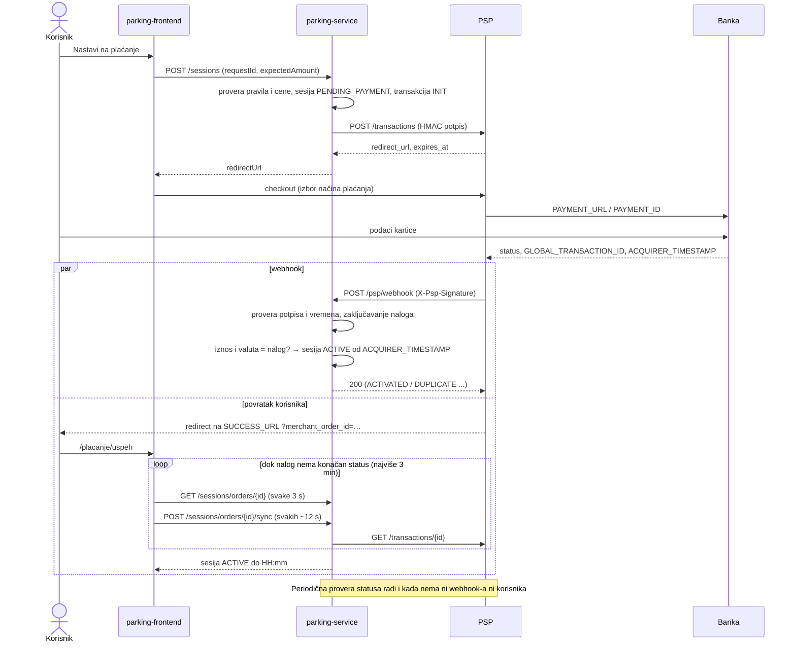

# Aktiviranje parking sesije

Parking sesija prelazi iz `PENDING_PAYMENT` u `ACTIVE` **isključivo** kada parking sistem dobije od PSP-a
potvrdu uspešnog plaćanja sa istim iznosom i valutom kao u nalogu. Povratak korisnika na `SUCCESS_URL` ne
aktivira ništa — služi samo za prikaz.

Potvrda stiže na dva nezavisna načina, a oba prolaze kroz isti kod (`PaymentOutcomeService`):

| Izvor | Kada | Ko je u tragu statusa |
|---|---|---|
| Webhook `POST /psp/webhook` | PSP ga šalje odmah posle konačnog statusa i ponavlja dok ne dobije `2xx` (10 s, 20 s, 40 s…) | `PSP` · webhook |
| Provera statusa `GET /transactions/{merchant_order_id}` | periodično (svakih 30 s za naloge starije od 60 s, svaki najviše jednom u 60 s) i na zahtev stranice statusa plaćanja | `SYSTEM` · provera statusa |

## Tok

## Pravila

| Situacija | Ishod |
|---|---|
| `SUCCESS`, iznos i valuta se poklapaju | transakcija `SUCCESS`, sesija `ACTIVE`; plaćeno vreme teče **od trenutka odobrenja plaćanja** (`ACQUIRER_TIMESTAMP`, ili trenutak prijema potvrde ako ga nema), kraj = početak + plaćeno trajanje |
| `FAILED`, `EXPIRED`, `ERROR` | sesija `CANCELLED`, ništa se ne aktivira |
| PSP javi drugi iznos ili valutu | transakcija `ERROR`, sesija `CANCELLED`; ako je naplata uspela → refundacija |
| `SUCCESS`, a vozilo je u međuvremenu dobilo drugu aktivnu sesiju | sesija `CANCELLED`, refundacija |
| `SUCCESS` stigne posle već upisanog `EXPIRED`/`ERROR` (kasna potvrda) | transakcija `SUCCESS`, sesija ostaje zatvorena, refundacija |
| Ponovljen webhook ili provera istog konačnog statusa | ništa se ne menja (`DUPLICATE`) — prvi konačan status pobeđuje |
| PSP ne poznaje nalog (inicijalizacija nikad nije stigla) 15 min posle kreiranja | transakcija `EXPIRED`, sesija `CANCELLED` |
| PSP nije dostupan pri proveri | ništa se ne menja, provera se ponavlja |

Vreme odobrenja se ograničava na interval [kreiranje naloga, sada], kako pogrešan sat na strani banke ili PSP-a
ne bi pomerio period parkiranja.

**Refundacija:** uspešno plaćanje koje ne može da aktivira sesiju dobija `refund_status = REQUIRED`, razlog i
vreme zahteva, a u tragu statusa događaj `REFUND_REQUIRED`. Korisnik to vidi na stranici statusa plaćanja i
u istoriji („Čeka refundaciju”). Sam povraćaj zahteva refund API na PSP-u, koji još ne postoji; kada bude
dodat, poziva se za transakcije sa `REQUIRED` i one prelaze u `REFUNDED`.

## Bezbednost webhook-a

- Putanja je javna (PSP nema JWT korisnika), ali se prihvata samo zahtev sa ispravnim
  `X-Psp-Signature = hex(HMAC-SHA256(tajna, timestamp \n POST \n /psp/webhook \n sha256(telo)))`,
  izračunatim nad tačno primljenim bajtovima tela; poređenje je u konstantnom vremenu.
- `X-Psp-Timestamp` sme odstupati najviše 5 min (zaštita od ponovljenih zahteva).
- Iznos i valuta iz webhook-a se uvek porede sa nalogom; status, iznos i nalog ne mogu biti promenjeni
  nepotpisanim zahtevom.
- Svaki prijem (i odbijen) upisuje se u `psp_webhook_event`: ID isporuke, događaj, nalog, status, da li je
  potpis ispravan i ishod obrade.
- Red transakcije se zaključava (`SELECT … FOR UPDATE`), pa webhook i provera statusa ne mogu istovremeno da
  obrade isti nalog.

## Podešavanje

U PSP portalu (klijent `MRC-00042`, Metode i integracija) webhook URL treba da bude
`http://parking-service:8081/psp/webhook` (PSP i parking servis su u istoj Docker mreži). Ako se koristi
druga putanja, ista se postavlja u `PSP_WEBHOOK_PATH` jer ulazi u potpis.
